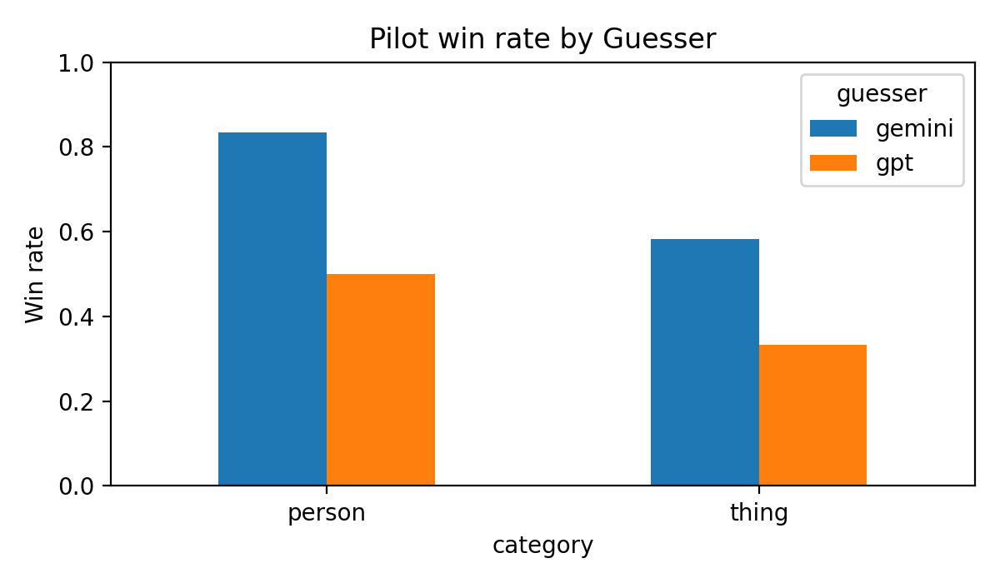

# How Good Are LLMs at 20 Questions?

An evaluation of large language models playing **20 Questions** in both roles and across model pairings, with metrics that go beyond win rate.

> **Status:** Proposal submitted · Pilot complete (48 games) · Full experiment in progress
> Course project for CSE 519 (Data Science Fundamentals), Stony Brook University, Fall 2026.

---

## The question

20 Questions is a small, controlled test of things LLMs are supposed to be good at: forming hypotheses, asking informative questions, tracking state over many turns, and answering consistently about a hidden fact.

We study it from **both sides of the table**:

| Role | What the model does | What we're testing |
|---|---|---|
| **Answerer** | Holds the secret word and answers yes/no questions about it | Honesty and consistency across a whole game |
| **Guesser** | Asks up to 20 yes/no questions or guesses, one per turn | Strategy, information gain per question, efficiency |

> **Terminology:** *Answerer* = model holding the secret word. *Guesser* = model asking questions. Used consistently in the code and writeup.

## Setup

- **Words:** test split of the [Entity Deduction Arena](https://huggingface.co/datasets/yizheapple/entity-deduction-arena) dataset: **101 things** and **100 celebrities** (one merged entry in the source file, `CelloMarshmallow`, is split into two words).
- **Models:** accessed through [OpenRouter](https://openrouter.ai), chosen from the same price tier so the comparison is fair:

  | Key | Model |
  |---|---|
  | `claude` | `anthropic/claude-haiku-5.5` |
  | `gpt` | `openai/gpt-5.4-mini` |
  | `gemini` | `google/gemini-3.8-flash` |
  | `deepseek` | `deepseek/deepseek-v4.1-flash` |

- **Game rules:** 20 turns. A guess uses a turn. The Answerer runs at temperature 0 and must reply with exactly *Yes* or *No*. The Guesser runs at temperature 0.7.
- **Scoring a guess:** exact match after normalization (case, articles, punctuation). If that fails, an LLM judge decides whether the guess names the same entity (e.g. "Paris, France" vs "Paris").
- **Logging:** every game is appended to a JSONL file as it finishes: each question, answer, raw answer text, guess, token count and dollar cost. Runs can resume after a disconnect, and every metric can be recomputed from the raw logs.

## Pilot results

**2 models (`gpt`, `gemini`) × 4 ordered pairings (each model plays both roles, including against itself) × 12 words (6 things, 6 celebrities) = 48 games.**

Notebook: [`notebooks/twenty_questions.ipynb`](notebooks/twenty_questions.ipynb)

### Win rate by pairing

| Guesser ↓ / Answerer → | `gemini` | `gpt` |
|---|---|---|
| **`gemini`** | **83%** (avg 15.2 turns to win) | 58% (17.3) |
| **`gpt`** | 33% (14.8) | 50% (18.0) |

### Win rate by category

| Guesser | Celebrities | Things |
|---|---|---|
| `gemini` | 83% | 58% |
| `gpt` | 50% | 33% |



### Observations

- **Gemini was the stronger Guesser:** 17/24 wins vs 10/24 for GPT. Which model was the Answerer mattered much less by win rate (14/24 vs 13/24 wins).
- **Celebrities were easier than things** for both Guessers. People can be split cleanly by era, field and nationality. Everyday objects have fuzzier categories.
- **Answerers followed the format perfectly** (0 invalid replies out of 785 questions), **but did not always answer correctly.** Spot checks found factually wrong answers, and each one ended in a loss:
  - *Apple*: "Is it man-made?" → **Yes**
  - *Meryl Streep* (born 1949): "Was she born before 1960?" → **No**
  - *Patrick White* (male, born in London): "Is the person an adult male?" → **No**, and "Was the person born in Europe?" → **No**

  All of these came from GPT as the Answerer. A wrong answer poisons the rest of the game, so the honesty metric isn't optional: some "Guesser losses" are really Answerer failures.
- **GPT guesses inside questions.** It asked 30 disguised-guess questions (e.g. *"Is the person Katie Ledecky?"*) across 13 games. Gemini asked 1. Nine times a disguised guess got a *Yes* and GPT then spent another turn making the formal guess. Question quality has to separate real splitting questions from these.
- **Shared opening habits:** in 10 of 24 "thing" games, both Guessers asked whether the item is used in the kitchen, including for yarn, umbrella and broom.
- **Losses were never silent:** all 21 losing games included at least one wrong guess. No Guesser ran out the clock without guessing.
- **Caveat:** 12 games per cell is small. These numbers show the pipeline works. They are not final conclusions.

<details>
<summary>Sample game (median-length win)</summary>

```
Secret: Katie Ledecky | Guesser: gpt | Answerer: gemini
Q1:  Is the person primarily known for being alive in the 21st century?  -> Yes
Q2:  Is the person primarily known for entertainment or sports rather than politics, science, or business?  -> Yes
Q3:  Is the person primarily known as an actor or actress?  -> No
Q4:  Is the person primarily known as a musician or singer?  -> No
Q5:  Is the person primarily known as a professional athlete?  -> Yes
Q6:  Is the person primarily known for playing a team sport?  -> No
Q7:  Is the person primarily known for a combat or individual sport?  -> Yes
Q8:  Is the person primarily known for tennis?  -> No
Q9:  Is the person primarily known for boxing or mixed martial arts?  -> No
Q10: Is the person primarily known for golf?  -> No
Q11: Is the person primarily known for motorsports?  -> No
Q12: Is the person primarily known for gymnastics or figure skating?  -> No
Q13: Is the person primarily known for track and field or swimming?  -> Yes
Q14: Is the person primarily known for swimming?  -> Yes
Q15: Is the person Michael Phelps?  -> No
Q16: Is the person Katie Ledecky?  -> Yes
G17: Katie Ledecky  -> CORRECT
```
Q8–Q12 show a typical weakness: the Guesser checks one sport at a time instead of splitting the remaining options in half.
</details>

### Cost

Average **12,019 tokens** and **$0.0186 per game** (cost tracked for 40 of the 48 games). The full experiment comes to about **$60** at pilot-model prices.

## Full experiment plan

- **4 models** (table above), **every ordered pairing including self-play** → 16 Guesser/Answerer combinations
- **All 201 words** per pairing → **3,216 games**
- Runs are shuffled, so if a run stops early every pairing still has games. The run resumes by skipping games already in the log.

## Metrics

| Metric | What it measures |
|---|---|
| **Win rate** | Share of games where the Guesser names the word within 20 turns |
| **Turns to win** | Efficiency of successful games |
| **Question quality** | How close each question comes to splitting the remaining possibilities in half (information gain); disguised guesses are counted separately |
| **Answerer honesty** | Whether answers stay consistent with the secret word across the whole game |
| **Secret-word randomness** | How the words a model picks when asked to choose one compare with a true random sample |

## Repository layout

```
.
├── README.md
├── notebooks/
│   └── twenty_questions.ipynb   # pilot harness + analysis (Colab)
├── src/                         # game engine, model wrappers, metrics (full experiment)
├── data/
│   └── pilot_games.jsonl        # raw game logs, one game per line
├── results/
│   ├── pilot_table.csv
│   └── figures/
│       └── pilot_winrate.png
├── docs/
│   └── proposal.pdf
└── requirements.txt
```

## Running it

The notebook is written for **Google Colab**:

1. Open `notebooks/twenty_questions.ipynb` in Colab.
2. Add an `OPENROUTER_API_KEY` secret (🔑 icon in the left sidebar) and turn on *Notebook access*.
3. Run all cells. Games are written to `MyDrive/cse519_20q/games.jsonl`. Rerunning the run cell continues where the last run stopped.

Rate limiting (18 requests/min per model) and an out-of-credits stop are built in. The analysis cells only read the saved log and make no API calls.

## Related work

- [Entity Deduction Arena](https://huggingface.co/datasets/yizheapple/entity-deduction-arena): the word lists used here
- Kaggle *LLM 20 Questions* competition
- Additional literature in the Background section of the [proposal](docs/proposal.pdf)

## Roadmap

- [x] Game harness with logging, resume and cost tracking
- [x] Pilot: 2 models, both roles, 48 games
- [x] Project proposal
- [ ] Move harness from notebook into `src/`
- [ ] Full run: 4 models, 16 pairings, 3,216 games
- [ ] Question-quality metric (information gain, disguised-guess detection)
- [ ] Answerer honesty check
- [ ] Secret-word randomness analysis
- [ ] Progress report
- [ ] Final report